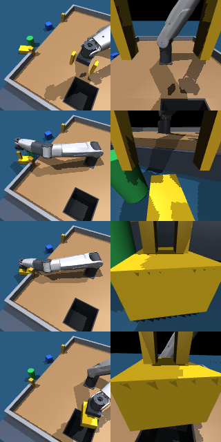
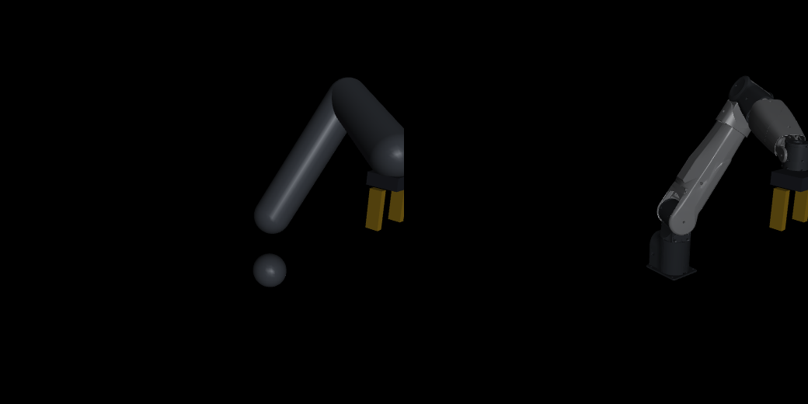

# VLA on vehicle —— 载具上的视觉-语言-动作抓取

一艘会晃的作业艇载着一条 7 轴机械臂去**打捞水面垃圾**：船头一支全局相机、腕部一支相机，
模型看图 + 读指令，把船舷外漂着的指定垃圾夹起来，转身丢进甲板上的内置垃圾舱。

和"在甲板上捡东西"的区别在于：**垃圾在世界系里是固定的，而机械臂的基座在晃**。
船一横摇，垃圾在相机画面里、在甲板系坐标里都会动 —— 这才把"载具"从背景变成扰动源。

控制与机械臂模型**直接复用** [`robotic_arm_on_vehicle`](https://github.com/Azurwolf1024/robotic_arm_on_vehicle)
的 `veh_arm`（NERO 厂商 URDF、FK/雅可比、解析动力学、载具 6-DOF 运动引擎），
本项目只新增**仿真场景 / 双相机数据管线 / 策略接口**。

```
        ┌─ 决策层 10 Hz ──────────────────────────────────────┐
        │ 全局图(船头) + 腕部图 + q,dq + 指令 "把红色易拉罐…"   │
        │            ↓  VLA / BC / 脚本专家                    │
        │ 动作 = [dx,dy,dz,g]  甲板系 TCP 增量 + 夹爪           │
        └─────────────────────────┬──────────────────────────┘
                                  ↓
        ┌─ 内环 100 Hz ─ DLS 逆解（复用 veh_arm 的 J/FK）────────┐
                                  ↓
        ┌─ 物理 500 Hz ─ MuJoCo + 上游载具 6-DOF 运动写入 ───────┐
```

---

## 0. 当前状态（v0.2：任务搬到舷外水面）

| 项 | 现状 |
|---|---|
| 场景 | 低干舷作业艇：0.96×0.72 m 甲板、干舷 0.12 m、−y 舷侧 0.44 m **作业口**、甲板开孔垃圾舱（深 0.10） |
| 垃圾 | 4 类（易拉罐/方块/纸箱/水瓶），漂在**船舷外水面** r ∈ [0.435, 0.55] m，每回合随机 3 件 |
| 双相机 | 船头全局 160×160 fovy 55°，腕部侧前方支架 160×160 fovy 80° |
| 动作 | 4 维：甲板系 TCP 增量（±2 cm/步）+ 夹爪 0/1，单回合上限 170 步 |
| 内环 | `pos` 关节位置伺服 + DLS 逆解（默认）／`tsid` 上游解析动力学 + QP 力矩环 |
| 参考系 | `deck`（默认，目标随甲板动）／`world`（目标钉在世界系） |
| 目标运动 | `pinned`（车载静对静）／`surface`（随水面升沉，船载真实工况）／`deck`（固连甲板） |
| 机械臂视觉 | 上游真实 NERO 网格（20 万面）／骨架胶囊，只影响渲染 |
| 专家（上界） | **30/30**：sea 0 / 0.35 / 1.0 × deck / world × 5 seeds；目标运动三档再加 **45/45** |
| 抓取精度 | 抓取瞬间 TCP 相对物体的**水平**偏差，sea 1.0：deck **2.6 mm** / world **1.0 mm** |
| 数据 | 160² 双相机、约 90 帧 → **1.6 MB 一条**（压缩 npz），采集 12 s/条 |
| 策略 | 行为克隆基线（双相机 + 指令 + 本体感觉，~1.5 M 参数，CPU 可训），见 §5 |
| 预训练 VLA | **只有接入位**（`policies/vla_adapter.py`），未接权重 —— 见 `docs/vla_interface.md` |
| 测试 | 24 条，含"MuJoCo FK 与上游 FK 逐点一致（1e-7）"、"解析动力学与 MuJoCo 逐项一致（1e-6）"、"两档视觉是同一个被控对象"、"完整抓放跑通" |

> **三个必须说清楚的结论**
>
> 1. **任务成功率对海况与参考系都不敏感**（三档海况 × 两种参考系全通过）。
>    差别只在**精度**上：`world` 系把抓取偏差从 2.6 mm 压到 1.0 mm（2.6 倍）。
>    因为夹爪开口 84 mm、物体 40–100 mm，3 mm 还不足以造成失败 ——
>    所以现在能证明的是"补偿有效"，还不能证明"不补偿就失败"。
> 2. **"目标随海况动"不会让任务变难，反而更好追**。船和垃圾漂在同一片波上，升沉是共模的：
>    sea 1.0 下目标在甲板系里的晃动 `pinned` 66.7 mm → `surface` 39.7 mm（升沉 86.5 mm 被抵消）。
>    最难的一档恰恰是"目标钉在世界系 + 船在摇"。见 §2。
> 3. **上游那套动力学模型与 MuJoCo 里的是同一份**（M/H/J 误差 1e-6 量级），
>    所以 `control/tsid.py` 能把 `TSIDController` 原样接上，见 §6。

---

## 1. 快速开始

```bash
# 0) 依赖：需要上游控制库（本项目不复制它的代码）
git clone https://github.com/Azurwolf1024/robotic_arm_on_vehicle.git ../robotic_arm_on_vehicle
#   或: export VLA_VEHICLE_UPSTREAM=/path/to/robotic_arm_on_vehicle
#   或: python scripts/fetch_upstream.py      # 拉到 third_party/

pip install -r requirements.txt

# 1) 看一眼场景（无显示环境用 --headless 导出 PNG）
python scripts/view_scene.py
python scripts/view_scene.py --headless --out runs/scene.png

# 2) 采集示范
python scripts/record_demos.py --episodes 30 --out data/demos

# 3) 训练行为克隆
python scripts/train_bc.py --data data/demos --out runs/bc --epochs 15

# 4) 闭环评测（上界 / 学到的策略 / 下界）
python scripts/eval_policy.py --policy expert --episodes 20 --seed0 1000
python scripts/eval_policy.py --ckpt runs/bc/policy.pt --episodes 20 --seed0 1000
python scripts/eval_policy.py --policy random --episodes 10

# 5) 测试
python -m unittest discover -s tests -t .
```

三档工况（配置文件在 `configs/`）：

```bash
python scripts/eval_policy.py --policy expert --config configs/sea_calm.yaml   # 载具不动
python scripts/eval_policy.py --policy expert                                  # sea 0.35（默认）
python scripts/eval_policy.py --policy expert --config configs/sea_rough.yaml  # sea 1.0
```

---

## 2. 任务与场景

```
        +y (左舷)
         ↑            ┌─────┐ ← 垃圾舱, 内腔 0.15×0.13, 深 0.10, 中心 (0.32, 0.06)
         │            └─────┘
         │        █ 机械臂基座 (0,0)
   ──────┼────────────────────────→ +x (船头)
         │  ═══════════   ← -y 舷墙上的作业口 (半宽 0.22), 舷墙在此断开
         │
    ≈≈≈ ○   ●   ≈≈≈    ← 垃圾漂在船舷外的水面上 (默认世界系固定, target_motion 可切)
         │   水面 z = −0.12
```

| 项 | 值 |
|---|---|
| 载具 | 上游 `VehicleMotion`：`sea` / `road` / `air` / `rail` / `static`，`scale` 调幅值 |
| 默认工况 | `sea, scale=0.35`（有义波高 ≈0.12 m，峰值线速度 ≈0.11 m/s） |
| 机械臂 | NERO 7-DOF，工具沿法兰法向 0.105 m，夹爪最大开口 84 mm |
| 干舷 | 甲板面比水面高 **0.12 m** —— 低干舷是"够得着水面"的前提 |
| 垃圾舱 | 甲板开孔 + 船体开孔，真凹坑 0.10 m 深；**不是**摆在甲板上的箱子 |
| 到达判据 | 目标物中心进入舱内腔（各边内缩 5 mm）且 z < −0.02 |

三个几何决定都能追到一个测量值（完整表见 `docs/sim.md` §2）：

* **干舷 0.12 m 而不是 0.30 m**：臂要伸到船舷外 0.45 m 处再向下 0.12 m。
  干舷 0.30 m 时那个点在工作空间之外。
* **垃圾舱放 −y 同侧 (0.32, 0.06)**：放在对角 (0.26, 0.26) 时单回合要横跨 0.72 m 甲板
  （97 步），而且船头相机必须同时包住对角两端，垃圾在 160² 画面里只有 6 px。
  改到同侧后 88 步、8 px，成功率不变。
* **工具偏航跟随目标方位角**：恒定 yaw=0 时，目标一到侧舷腕部 J7 就撞限位，
  r=0.45 处位置误差 29 mm（等于够不着）。跟随后同一目标 0.5 mm。

### 船载还是车载？

同一套几何两种读法：甲板 = 车厢底板、舷墙 = 护栏、作业口 = 侧向取物口、
内置垃圾舱 = 车厢垃圾箱。差别只在两件事：

| | 船载 | 车载 |
|---|---|---|
| 目标怎么动 | `surface`：随水面升沉 | `pinned`：地面不说谎，静对静 |
| 载具扰动（`scale=1.0`，12 s 窗口峰峰值） | 横摇 6.03° / 纵摇 12.59° / 升沉 190.9 mm | 横摇 1.14° / 纵摇 1.11° / 升沉 66.0 mm |

车的**角运动小 5–11 倍**，所以"车载先按静对静做"是站得住的 —— 即使车在跑，
姿态扰动也只有船的零头。真机上这条更明显：车没有横摇。

反过来，**"目标随海况动"也不像直觉以为的那么难**：船和垃圾漂在同一片波上，
升沉是共模的。sea 1.0 下目标在甲板系里的晃动从 `pinned` 的 66.7 mm 降到
`surface` 的 39.7 mm —— 世界系 86.5 mm 的升沉被抵消掉了。完整数据见
`docs/sim.md` §4.2。

```bash
python scripts/bench_target.py --episodes 5        # 三档目标运动 × 三海况 × 5 seeds
python scripts/view_scene.py --config configs/vehicle_mounted.yaml   # 车载静对静
```

---

## 3. 双相机

| | 全局（船头） | 腕部（掌侧支架） |
|---|---|---|
| 位置 | `(0.55, 0.02, 0.62)` 甲板系 | 工具系 `(0.080, 0, 0.040)`，自动瞄准 TCP |
| 视场 | fovy 55°，覆盖舷外水面垃圾 + 甲板 + 垃圾舱 | fovy 80°，两指缝隙 + 正下方 |
| 语义 | 挑哪一件、往哪放 | 最后 2 cm 的对位与夹持 |
| 随动 | 固连船体 → **随船摇** | 固连腕部 → 随臂动 |

两支相机都是刚体相机，没有做任何稳定化 —— 画面里的地平线会随船倾斜，这是**数据分布的一部分**。

腕部相机的装法试错了很多轮，结论是**沿 x（与指爪开合方向正交）侧移 8 cm**：

* 同轴装在两指之间：一夹住物体，物体距镜头 2 cm，画面被它糊满；
* 沿 y 侧移：相机落在**指垫背面**（指垫长 73 mm、从掌部一直伸到离 TCP 只有 2 cm），
  画面中间是一根巨大的黄色柱子；
* 沿 x 侧移 + 自动瞄准 TCP：两指缝隙是敞开的，物体在中间，指垫落在两侧。

判定方法不是"看图觉得行"，而是把 TCP / 指垫 / 掌部的包围盒投影到像素上量占屏面积
（`docs/sim.md` §7）。上面那根"黄色柱子"最后确认是**要抓的黄色纸箱**本身 ——
所以现在的流程是：先给几何体换醒目颜色确认遮挡源，再调参数。



*左：船头全局；右：腕部。自上而下为悬停、下探、抬起、投放。*

---

## 4. 数据和策略

```bash
python scripts/record_demos.py --episodes 30 --out data/demos
python scripts/train_bc.py --data data/demos --out runs/bc --epochs 15
```

一条回合存 `(全局图, 腕部图, q, dq, tcp, grip) → 动作(4)` 的 10 Hz 序列，
外加指令 token、成功标记、专家阶段名和一份环境参数快照。格式与体积见 `docs/data.md`。

策略只要满足 `policy.act(obs) -> (4,)` 就能闭环跑（`vla_vehicle/policies/base.py`）。
仓库里给了三个：脚本专家（上界）、行为克隆（可训基线）、随机（下界）。
预训练 VLA 的接入位是 `policies/vla_adapter.py`，`load()/infer()` **故意**抛
`NotImplementedError` —— 不做"看起来能跑其实没权重"的假实现。

---

## 5. 基线现状（先把话说清楚）

| 配置 | 训练侧 | 闭环成功率 |
|---|---|---|
| 专家（特权位姿，上界） | — | **30/30**（sea 0 / 0.35 / 1.0 × deck / world × 5） |
| 行为克隆（30 条示范，15 epoch，96² 输入） | val L1 = 0.144，夹爪准确度 97.6% | **0/8** |

BC 的失败模式很具体，而且和 v0.1 那次**不一样**：

| | v0.1（甲板任务） | v0.2（舷外任务） |
|---|---|---|
| 表现 | 走对了，但在离物体 7.7 cm 处闭爪 | 走对了方向，但**停在 26.5 cm 外**就闭爪 |
| 首次闭爪时距目标 | 0.077 m | 0.155 / 0.197 m |
| 平均回合 | 76 步耗尽 | 170 步耗尽（预算翻倍后仍然不够） |

后者更"根深蒂固"：任务变长之后（单程 0.5–0.6 m 的伸展），策略学到的是
"往这个方向走大约 N 步"，而**闭爪时机**还是从示范里拟合来的。误差在 10 Hz 的
多步累积下放大，于是它永远差最后一截。这是单步 BC 的协变量漂移，
在长视野任务上被放大了一倍。

对应的修法（写进 v0.2，`docs/roadmap.md`）：action chunk（一次预测 k 步，减少累积误差）、
更大的视觉输入（垃圾在 160² 里只有 8 px，96² 下只剩 4–5 px）、DAgger / 更多示范。
**在做出 50%+ 的闭环成功率之前，任何"VLA 效果好"的说法都不成立** ——
所以这一版仍然只交付链路与上界，不交付分数。

---

## 6. 上游 NERO 模型能不能搬到 MuJoCo

上游的控制算法不依赖任何仿真器：`veh_arm.robot.model.Robot` 自己算 `M(q)`、
`H = Cq̇ + g(R_WB) + τ_base`、`J`、`J_B`。本项目把**同一个** `ArmSpec` 编译成 MJCF，
所以两边构造上同源；`tests/test_dynamics.py` 再逐项验证它们确实是同一个被控对象：

| 验证项 | 对比对象 | 相对误差 |
|---|---|---|
| `M(q)` | `mj_fullM`（扣掉 armature 0.02） | **4.5e-6** |
| `H = Cq̇ + g` | `qfrc_bias` | **1.8e-6** |
| `J`（6×7 世界系） | `mj_jacBody` | **1.4e-7** |

结论：不是"能凑合用"，而是同一个模型。于是 `vla_vehicle/control/tsid.py` 把上游
`TSIDController` 原样接上，MuJoCo 只负责接触与积分。

```bash
# 默认：关节位置伺服（采集/训练用这个）
python scripts/view_scene.py

# 力矩环 + 甲板系目标：任务语义不变，只是换成 QP 出力矩
python scripts/view_scene.py --control-mode tsid

# 力矩环 + 世界系目标：末端钉在世界上，唯一能体现"抗船摇"的配置
python scripts/view_scene.py --control-mode tsid --control-frame world --vehicle-scale 1.0
```

配置里等价于 `env.control_mode` / `env.frame` / `env.tsid.*`，见 `configs/tsid_world.yaml`。

### 实测（`python scripts/bench_control.py --episodes 3 --tsid-episodes 2`）

同一条舷外任务、同一批种子（200+）上比两个内环：

| 内环 / 参考系 | 成功率 | 平均步数 | 抓取偏差 | CPU 秒/回合 |
|---|---|---|---|---|
| `pos` / deck | 3/3 | 84.7 | 1.3 mm | **2.7** |
| `pos` / world | 3/3 | 85.3 | 0.6 mm | 2.9 |
| `tsid` / deck | 2/2 | 82.0 | 0.8 mm | 9.0 |
| `tsid` / world | 2/2 | 84.5 | 0.8 mm | 9.1 |

（sea 0.35。`pos` 那两行与 §0 的表来自不同随机种子集，所以数字略有出入 ——
`scripts/bench_frame.py` 用 seed 0–4，这里用 seed 200+。）

零动作保持 3 s，量 TCP 在**世界系**的游走（sea 1.0）：

| 内环 / 参考系 | 平均 | 最大 |
|---|---|---|
| `pos` / deck | 12.3 mm | 26.1 mm |
| `tsid` / deck | 12.4 mm | 26.4 mm |
| `tsid` / world | **0.7 mm** | **1.0 mm** |

注意读法：`pos` 与 `tsid` 在 deck 系下一样差 —— 因为它们的**目标本身**在随船动。
18 倍差距来自**换参考系**，不是内环本身。真正被验证的是：上游的基座运动前馈
在 MuJoCo 里成立，能把船摇对末端的影响压到毫米级。细节与边界见 `docs/control.md`。

### 视觉：仿真里那条臂就是 NERO

上游 `models/nero_stl/` 里存着厂商 SolidWorks 导出的 12 件 STL（就是 Blender 渲染用的那一套），
`scene.visual="mesh"` 直接把其中 8 件（`base_link` + `link1..7`）挂到对应连杆上。
STL 顶点**就在 URDF link 坐标里**，以 identity 挂载即可，不用任何补偿变换。

```bash
python scripts/view_scene.py --visual mesh       # 真实外壳（20 万面）
python scripts/view_scene.py --visual capsule    # 骨架胶囊（默认自动：有网格就用网格）
```

两档是**同一个被控对象**，`tests/test_visual.py` 守死：`M(q)` 与 `bias` 逐位相同、
总质量相同（5.1202 kg）、视觉 geom 一律 `contype=0`。



*同一个位形。左 `capsule`，右 `mesh` —— 连关节外壳、螺栓孔、走线槽都在。*

> **坑**：`<geom type="mesh">` 所在 body 若没写 `<inertial>`，MuJoCo 会按网格体积**当实心体**
> 估质量 —— 基座凭空多 0.73 kg。基座焊在载具上没有自由度，`M` 不受影响，但"整臂质量"
> 必须对得上厂商参数，现在从上游 URDF 读（1.0646 kg）。
>
> **夹爪和法兰刻意不用网格**：厂商 `flange_link` 相对 link7 有 90° 相位差，
> 真实夹爪行程 100 mm/侧，而本仿真的指垫是 32 mm 行程、形状与摩擦都标定过的接触几何。
> 硬套网格会让"看到的"和"碰到的"分家。

### 接的过程中踩到三个坑（都改了代码，没改上游）

1. **转子惯量必须进 QP**。MuJoCo 的 `armature`（0.02）上游模型里没有，而 NERO 腕部
   连杆惯量只有 1e-3 量级。事后补 `τ += A·q̈` 会让 QP 的力矩约束失真（实测关节 4 要求
   47 N·m、上限 40），电机一饱和就进极限环。改成 `_ArmatureRobot` 把 A 加进 `M` 再进 QP。
2. **TCP ≠ 法兰**。上游 `ee_pose` 是法兰，任务目标是 TCP（+105 mm）。不换基就是
   让控制器追一个偏出 10 cm 的虚点，现象是"臂一直朝错的方向爬"。
3. **vessel 之前是自由体**。每步都在重力下自由下落（0.1 s 掉 4.9 cm），只是被逐帧覆写
   qpos 掩盖了。位置伺服靠硬刚度扛住了，力矩环立刻崩（给 `τ=g(q)` 做重力补偿，臂掉
   4.34 rad）。改成 mocap 运动学平台后同一实验 0.054 rad。诊断法是**开环**给
   `τ = M q̈* + H`，看 MuJoCo 返回的 `qacc` 是否等于 `q̈*` —— 不等就说明问题在场景，
   不在控制器。详见 `docs/architecture.md` §2.4。

---

## 7. 目录结构

```
VLA_on_vehicle/
├── vla_vehicle/
│   ├── deps.py              上游 veh_arm 的解析（安装/兄弟目录/third_party 三级回退）
│   ├── config.py            YAML → dataclass（写错键名直接报错）
│   ├── robot/
│   │   ├── arm.py           NERO 复用 + TCP/夹爪参数 + READY 位形
│   │   ├── mjcf.py          ArmSpec → MJCF（与上游同源，FK 逐点一致）+ 真实网格
│   │   └── urdf_fix.py      ★ 修补上游把 URDF 惯量读成 0 的缺陷
│   ├── sim/
│   │   ├── scene.py         甲板/作业口/垃圾舱/水面/相机/垃圾装配
│   │   ├── objects.py       垃圾库 + 指令模板 + 字符级分词
│   │   └── env.py           载具驱动 + 三级时序 + 双相机观测 + 成功判据
│   ├── control/
│   │   ├── ik.py            DLS 逆解（基座系，带零空间偏好）
│   │   ├── tsid.py          ★ 上游解析动力学 + TSID 力矩环（臂型解耦）
│   │   └── expert.py        脚本专家（分阶段 + 位移限幅 + 落底等待）
│   ├── data/                回合结构 / 录制器 / 训练 Dataset
│   └── policies/            策略接口 / BC 基线 / 预训练 VLA 接入位
├── scripts/                 record_demos · train_bc · eval_policy · view_scene ·
│                            bench_control · bench_frame · bench_target · fetch_upstream
├── configs/                 default · sea_calm · sea_rough · sea_surface · sea_deck_cargo ·
│                            vehicle_mounted · vehicle_road · train_bc · tsid_world
├── tests/                   24 条：运动学 / 动力学 / 视觉档等价 / 环境契约 / 端到端 / 数据
├── results/bench/           专家成功率的三档基准 + 内环对照
└── docs/                    architecture · sim · control · data · vla_interface · roadmap
```

---

## 8. 上游依赖与一个上游缺陷

本项目**不复制** `veh_arm` 的代码，运行期从上游导入（`vla_vehicle/deps.py`）。
这样机械臂模型只有一个真相源，改限位/换 URDF 不会两边漂移。

顺带发现并修了一个上游缺陷：`veh_arm.robot.urdf_io._inertia_from_urdf` 用
`el.find("ixx")` 按**子元素**读惯量，而标准 URDF 把六个分量写成**属性**，
于是 NERO 七个连杆的转动惯量全部被读成 0（不报错）。
运动学完全不受影响，所以上游的跟踪精度结论依然成立；但任何依赖 `M(q)` 的动力学量、
以及 MuJoCo 的编译都会出问题（`inertia must have positive eigenvalues`）。
`vla_vehicle/robot/urdf_fix.py` 重新按属性读一遍补上，并有单测守着。

---

## 9. 已知限制

1. **抓取用运动学吸附**（`grasp_mode="attach"`）：闭合到位即把物体钉在工具上。
   纯接触摩擦在这个质量比下会持续滑移（实测 40–180 mm），诊断过程写在 `docs/sim.md` §5.3。
   释放后的下落、落点、碰撞仍是真物理。
2. **没有旋转动作**，工具姿态由内环决定（朝下 + 偏航跟随方位角）。侧向抓取需要 6 维动作。
3. **只有取物侧在世界系**：垃圾漂在水面上（世界系固定），但投放目标仍是甲板上的桶。
   两侧都放到世界系（把桶换成岸上/水面固定点）是 v0.3 的剩余项。
4. **末端估计器还没接**：仿真里把真值基座位姿/速度/加速度直接喂给控制器。
   真机上游用的是 ESKF，噪声与滞后都还没进来。
5. **没有真机**；行为克隆的样本量还远不够给出有意义的成功率，现在只证明链路可通。
6. **水面是理想平面**：垃圾不会随波起伏，也不会漂走。真实水面需要加波浪与流。

---

## 10. 许可

MIT，见 [LICENSE](LICENSE)。上游 `robotic_arm_on_vehicle` 的许可证见其仓库；
NERO 的 URDF 由上游自带，本项目不重新分发。
